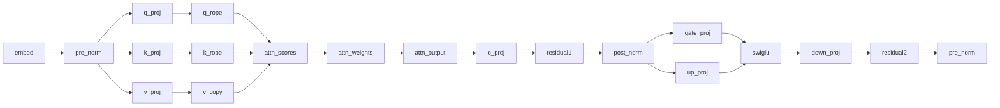

# muyo-llm graph model

Generated from the node and dependency declarations before `Build()` by
`MUYO_RG_DOT=<path> ./muyo_llm --forward <gguf> -p hi` (see `docs/graph/README.md`).
The diagram syntax is Muyo's `RenderGraph::ToDot`/`ToMermaid`; this repo only projects the
declared nodes and edges into the `TraceGraph` topology they take. GitHub renders the
Mermaid below natively.

## Overview

Each layer is one node; the label on an edge is how many authored edges it
collapses. `embed → layer 0 … layer 23 → final_norm → lm_head → argmax`.

## Layer 0

The 18-node transformer unit, with the embedding it reads and the next layer it
feeds as context.

